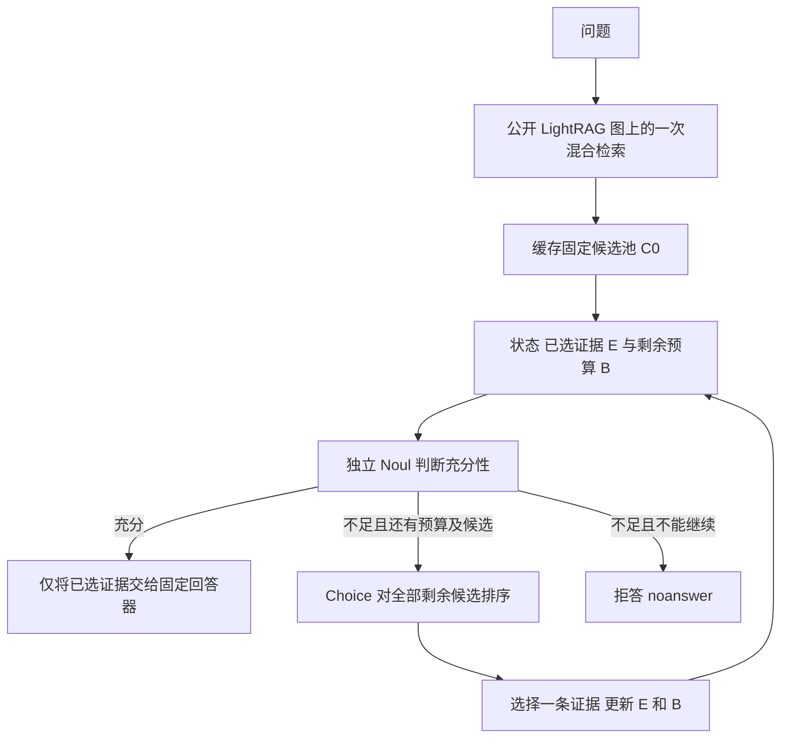

# SA-Jev 研究问题 方法 数据与实验详解

更新日期：2026 年 11 月 8 日。代码核对基线：`329e1ea` 及当前工作区。本文对应默认配置 `configs/public_lightrag.yaml`、公开索引后端 `public_lightrag_n500_v1`、问题划分协议 `published_family_split_v2`。

这份说明面向希望理解并实际开展论文实验的项目研究者。SA-Jev 的目标是：在已经召回的证据中，随已选证据变化，判断下一条最值得读的证据，并判断什么时候已经足够回答。它复用训练好的 OpenJev-4B，研究动态证据决策，而不训练一个新检索器或新回答大模型。

**目前具备研究代码和小规模联调证据，但尚无 OpenJev-4B 正式训练结果，也没有“优于基线”的实验结论。** 本文将已实现行为、已实际核验的数据，以及尚待实验验证的假设分开说明。当前最需要关注的有效性问题是：排序监督为支持覆盖代理；未知候选会减少有效排序监督；公开图只覆盖特定题目范围；独立扰动测试还需要人工核验。

## 阅读导航

- [1 研究到底要解决什么](#1-研究到底要解决什么)
- [2 相关工作和本项目的研究位置](#2-相关工作和本项目的研究位置)
- [3 方法与算法框架](#3-方法与算法框架)
- [4 OpenJev 如何适配](#4-openjev-如何适配)
- [5 标签究竟从哪里来](#5-标签究竟从哪里来)
- [6 一个贯穿全部损失的例子](#6-一个贯穿全部损失的例子)
- [7 两阶段损失与训练过程](#7-两阶段损失与训练过程)
- [8 数据来源规模和当前配方](#8-数据来源规模和当前配方)
- [9 训练数据构建流程](#9-训练数据构建流程)
- [10 验证测试与独立扰动构建](#10-验证测试与独立扰动构建)
- [11 数据文件如何对应损失](#11-数据文件如何对应损失)
- [12 基线如何设置与复用](#12-基线如何设置与复用)
- [13 指标和统计口径](#13-指标和统计口径)
- [14 实验分别检验什么](#14-实验分别检验什么)
- [15 Notebook 逐本说明](#15-notebook-逐本说明)
- [16 运行配置顺序和资源](#16-运行配置顺序和资源)
- [17 API 费用和缓存究竟发生在哪里](#17-api-费用和缓存究竟发生在哪里)
- [18 已验证内容与尚未完成的研究工作](#18-已验证内容与尚未完成的研究工作)
- [19 代码阅读路线](#19-代码阅读路线)
- [20 论文表述建议](#20-论文表述建议)
- [21 参考资料](#21-参考资料)

## 1 研究到底要解决什么

### 1.1 相关不等于现在值得再读

设问题需要两条支持事实 A、B。候选中有 A 的多个相关描述，还有 B 和一些干扰段落。只根据“与问题是否相关”排序，可能连续选择 A 的不同描述，预算耗尽仍缺 B。

读过 A 以后，A 的另一种描述仍然相关，但新增支持价值可能为零。B 的价值则相对上升。因此要学习的是 `价值(问题, 已选证据, 候选)`，而不只是 `相关性(问题, 候选)`。

### 1.2 排得第一不代表证据已经充分

Choice 概率是在当前候选之间比较出来的。即使所有候选都没用，也必然有一个排第一。反过来，已经读到了完整支持链时，剩余候选仍可以有一个最高分。因此不能把 `max(p)` 当作“已经能回答”的概率。

SA-Jev 用独立判断回答：“只凭已经选择的证据，是否足够？”回答器只在模型接受当前证据时生成答案，否则明确拒答。

### 1.3 稳定不等于对变化没有反应

输入换行、字段呈现顺序或无关背景变化，不应造成不必要的决策翻转。但是新增一条关键证据后，下一步排序和充分性应该能够变化。研究同时测量：

1. **不该变时是否稳定**：无关变化下的排序、概率和停止决策波动。
2. **该变时是否正确响应**：新增有效支持后，是否转向仍缺失的证据或正确停止。
3. **最终是否有用**：证据覆盖、回答质量和成本是否改善。

上述都是待检验的问题。诊断若显示原模型已经稳定，或稳定性损失没有收益，论文应如实报告，不能为了维护假设修改结果口径。

## 2 相关工作和本项目的研究位置

下面的“未直接回答”指这些工作的主要设置与本项目的控制变量不同，**不表示它们完全没有相关机制，也不构成已经证明的文献空白或首次性声明**。

| 工作方向 | 已解决或主要研究的问题 | 本项目仍需单独回答的问题 |
|---|---|---|
| Microsoft GraphRAG | 用图结构及社区摘要支持面向语料的全局问答和查询导向总结 | 固定相同召回结果后，如何逐条选择证据并控制停止行为 |
| LightRAG | 图结构、实体与关系的双层检索以及向量信息结合 | 不改变召回器时，证据的状态相关边际价值能否学习 |
| HippoRAG 2 | 图上的非参数记忆、段落融合及在线检索 | 检索以后，学习决策器是否能更好利用同一个候选池 |
| RankGPT | 利用生成式大模型重排检索段落 | 多次证据获取时的动态增益、独立充分性和停止轨迹训练 |
| IRCoT | 将推理步骤与多轮检索交替执行 | 限定只召回一次后，是否仍能通过选择策略获得收益 |
| Self-RAG | 按需检索和生成中的自我评判 | 一个专门输出决策概率的 4B 模型，如何在固定候选集上做证据选择 |
| OpenJev | 面向请求定义的自然语言选项输出概率，提供 Choice/Noul 等接口 | 如何利用 QA 支持标注适配动态证据决策，并评价无关变化与有效变化 |
| 公开图来源论文 | 研究 Graph-RAG 的回答推理瓶颈、结构化提示与上下文压缩 | 本项目控制回答器，单独研究证据选择及停止策略 |
| DPO 与一致性正则 | 偏好优化和减少预测不一致的通用工具 | 如何将完整 READ/STOP 轨迹与合法状态视图约束用于此任务 |

对应一手来源：[GraphRAG](https://arxiv.org/abs/2404.16130)、[LightRAG](https://arxiv.org/abs/2410.05779)、[HippoRAG 2](https://arxiv.org/abs/2502.14802)、[RankGPT](https://aclanthology.org/2023.emnlp-main.923/)、[IRCoT](https://aclanthology.org/2023.acl-long.557/)、[Self-RAG](https://arxiv.org/abs/2310.11511)、[OpenJev 仓库](https://github.com/ejhshen/OpenJev)、[公开图来源论文](https://arxiv.org/abs/2603.14045)、[DPO](https://arxiv.org/abs/2305.18290)、[R-Drop](https://arxiv.org/abs/2106.14448)。

### 2.1 可以主张的贡献方向

**第一，任务适配。** 将 OpenJev 的开放选项决策能力用于固定 GraphRAG 候选池中的动态边际证据选择，并将边际排序、支持相关性和当前充分性明确分开。

**第二，监督和优化的组合。** 用原始支持标注构造状态级代理监督，再用完整证据轨迹偏好约束选择与停止行为；等义视图仅承担轻量正则化作用。

**第三，联合评价。** 同时衡量无关变化下的稳定性和有效状态变化下的响应能力，并在相同候选池、预算、回答器下进行配对比较。

这些是拟研究的贡献，不是已成立的性能结论。使用已有 DPO、L2 正则或公开图本身不构成新的算法理论；采用公开索引主要改善成本和可复现性。论文能否形成有力创新，要取决于诊断、有效监督规模、消融和泛化证据。

### 2.2 与原版 OpenJev 的关系

OpenJev 是本项目复用的开源实现和训练产物，不能与官方 Jev API 的内部实现、训练数据或能力画等号。原版 OpenJev 的第二阶段为 REINFORCE-Analysis；本项目改用离线轨迹 DPO，是研究扩展。相关描述应写“基于已训练 OpenJev-4B 的任务微调”，不能写“完整复现原版 Jev 训练”。实现来源见 [OpenJev 仓库](https://github.com/ejhshen/OpenJev)，本项目适配见 [model.py](../src/sa_jev/model.py)。

## 3 方法与算法框架

### 3.1 符号和信息边界

| 符号 | 含义 | 是否可输入模型 |
|---|---|---|
| `q` | 原始问题文本 | 是 |
| `C0` | 一次检索得到的固定初始证据池 | Choice 可见剩余候选；充分性不可见其未选正文 |
| `E_t` | 已选证据序列 | 是 |
| `C_t = C0 \ E_t` | 当前未选候选 | 只参与本轮选择等相关任务 |
| `c_t` | 有效条件 | 是；变化时需要相应标签 |
| `n_t` | 其他上下文，如日志或背景 | 是；不能暗示金标 |
| `B_t` | 剩余 READ 次数 | 是 |
| `U_q`、`F(e)` | 金标支持单元及证据覆盖 | 仅用于标签和评测 |
| `answer`、分解答案 | 原始答案和分解监督 | 不进入决策输入 |

当前基本训练状态通常是空 `conditions`、空 `context`；已选证据和预算真实变化。代码接口支持条件字段，但默认训练数据并不等于已经覆盖多种有效条件变化。

### 3.2 数据流



图中的检索发生一次。训练时不对 LightRAG 反向传播；正式评测的检索通常已经在 00 中完成并缓存，04 直接重放缓存，因此运行 04 时不一定再看到检索 API 请求。

### 3.3 推理伪代码

```text
输入 q、固定池 C0、预算 B=4、充分性阈值 τ=0.5
E ← 空
循环：
    h ← Noul(q, 有效条件, E, 其他上下文, B)
    如果 h ≥ τ：用固定回答模型基于 E 回答；结束
    如果 B=0 或 C0\E 为空：拒答；结束
    p ← Choice(q, 状态, C0\E)  # 对全部剩余候选归一化
    i ← argmax p
    E ← E 加入证据 i；B ← B-1
```

最后一次 READ 使预算归零后仍判断充分性：若已经充分，可以回答；若仍不足则拒答。轨迹记录将预算结束标作 `BUDGET_END`，不会为了训练凭空添加一个自主 STOP 动作。

候选池是可追溯的文本证据块，不是直接将知识图谱的全部实体节点作为选项。LightRAG 通过实体、关系和向量召回定位证据；SA-Jev 对这些证据的标题、正文和 ID 做决策。它不在每一步沿图搜索新的节点。

## 4 OpenJev 如何适配

### 4.1 复用的结构

当前模型从 `shenjunhao/OpenJev-4B` 的固定 revision 加载原生 artifact。项目复用其语言骨干、序列化器、Option Set Interactor、共享决策头及校准温度。不同任务通过请求中的问题说明、选项和 criteria 表达，不是额外造三个独立大型网络。

从本地上游实现看，决策请求被编码为问题特征和各选项分支特征；投影后的选项表示经过集合交互层，再与问题表示计算兼容分数，最后对有效选项做 softmax。分支分批计算只降低峰值执行负担，**不能在每个分批内分别 softmax**。对应代码：[上游 head.py](../vendor/OpenJev/src/openjev/models/decision/head.py)、[本项目 model.py](../src/sa_jev/model.py)。

共享决策可以写作：

\[
p(i\mid q,S,C)=\frac{\exp(s_i/T)}{\sum_{j\in C}\exp(s_j/T)}.
\]

`T` 沿用 artifact 的校准温度。Noul 是两选项概率，`h = P(true)`；辅助相关性也是一条候选一次 Noul。所谓“充分性头”在任务层面是独立决策，当前实现中与 Choice 共享模型参数。

### 4.2 训练哪些参数

- 冻结原始骨干参数，在其线性层上加 LoRA，默认 `rank=16`、`alpha=32`、dropout 为 0。
- 训练原有完整 `core.head`，其中包括 Option Set Interactor；这些参数从已训练 artifact 初始化。
- 默认 BF16 加载骨干；head 的数值处理遵循上游实现，分数与 log-softmax 保持相应 FP32 计算。
- 启用分支 checkpointing 和 `branch_microbatch=1`，以计算换显存，保持梯度路径。
- 不训练本地 MiniLM 向量编码器，不训练回答 API 的模型。

现有 K=256 适配包含上游选项数量上限的最小扩展。它不代表 K=256 已在真实 4B 上验证可训练或高效；训练 K 最大为 64，128/256 是外推评测。

### 4.3 三类决策输入不同

| 决策 | 输入重点 | 输出用途 |
|---|---|---|
| Choice | 问题、完整当前状态、所有未选候选正文 | 下一条证据的相对价值与顺序 |
| 充分性 Noul | 问题、条件、已选证据、上下文、预算；没有未选候选正文 | 当前是否可以停止并回答 |
| 相关性 Noul | 问题与单条候选；不使用已选证据状态 | 辅助支持相关性监督 |

`context` 会出现在充分性请求中，因此提示明确要求只用 selected evidence 作为支持。独立扰动测试正是在检验模型能否遵守这一信息边界；仅靠提示不能先验保证它不受背景影响。

## 5 标签究竟从哪里来

### 5.1 原始 benchmark 有什么 没有什么

HotpotQA 提供问题、答案、上下文和句级支持事实；MuSiQue 提供多跳问题、分解及支持段信息；2Wiki 提供多跳 QA 的支持与推理信息。它们支持构造证据覆盖标签，但不直接提供“在任意当前状态下，全部候选的重要性从第一到第 K”的人工排名。来源：[HotpotQA](https://aclanthology.org/D18-1259/)、[MuSiQue](https://aclanthology.org/2022.tacl-1.31/)、[2Wiki](https://aclanthology.org/2020.coling-main.580/)。

本项目的标签因此有两个层次：原始人工/数据集支持标注是依据，状态级排序和充分性是程序依据覆盖规则推导的监督代理。DeepSeek 不负责为这些候选打重要性分数。

### 5.2 从支持单元到新增价值

对问题定义支持单元全集 `U_q`。HotpotQA 通常以支持句为单位，MuSiQue 以分解支持信息映射到支持段/单元。`F(e)` 是证据 e 覆盖的已标注支持单元，`F(E_t)` 为已选集合的并集。

\[
g_{ti}=\frac{|F(e_i)\cap(U_q\setminus F(E_t))|}{|U_q|},\qquad
y_{ti}=\frac{g_{ti}}{\sum_{j\in C_t}g_{tj}}.
\]

这个公式包含明确的排序信息：如果 `g_A>g_B`，目标就偏向 A；若增益相同则平分目标概率。它不会强行规定同样有用的两条支持证据谁必须先读。

局限也很明确：它按支持单元数量计权，不等于人类对关键性、因果依赖或实际回答帮助的完整评价。先读桥接事实是否比先读答案所在事实更合理，当前代理通常不额外奖励；替代支持链可能没有被原始标注穷举。

### 5.3 相关性与充分性

对可判定候选：

\[
r^*_{ti}=\mathbf{1}[F(e_i)\cap U_q\ne\varnothing],\qquad
z_t=\mathbf{1}[U_q\subseteq F(E_t)].
\]

`r*` 不随已选集合变化；`g` 随状态变化。重复支持 A 的候选可以 `r*=1` 但 `g=0`。`z=1` 表示覆盖了规定的支持单元，不表示已经用人工证明了开放世界下的逻辑充分性。

这里“合理”被拆成可操作目标：选择有新增支持的证据、在覆盖充分后停止、减少冗余读取。它不是一个覆盖所有推理合理性的大模型裁判分数。

### 5.4 未知不是负例

`labels_for` 会使用证据 ID、同源完整段落匹配、同源支持文本包含关系迁移标签。精确的来源约束用于防止把另一篇文章中相同的代词句误认为当前问题的支持。

- 已知原始干扰段可以按数据集标注作为代理负例；这仍不等于开放世界下绝对无用。
- 新召回但未核验的外部段落，不能因没匹配到金标就直接认作负例。
- 已选证据含未知内容且尚未覆盖完整支持时，负充分性通常也无法可靠判定。
- 支持原始标注不完整时，相关损失与指标须掩蔽。

**当前实现对排序尤其保守：只要剩余候选中有一条覆盖未知，整条状态的 `rank_valid` 就为 false。** 因为把它的软目标设为零同样是在施加负监督。即使已知候选中存在正增益，也不会绕过该限制。支持增益数值仍可能保存，但不因此自动启用排序损失。

这能避免伪负例，也可能严重减少训练和验证的排序监督。不能只报告“36,000 状态”，还必须报告 `rank_valid`、`suf_valid`、有效相关性条目数及其分数据集、分 K 的占比。

2026-11-12 用户确认的修复：训练优先使用原题已标注候选，删除未知项并接受较小实际 K；不再默认挖掘未标注的跨题 BM25 候选。正式验证/测试仍使用原始召回池，不能用 gold 删除未知项。已完成 00 时的备份修复命令、检查顺序和仍未解决的验证排序边界见 [排序标签覆盖修复](RANK_LABEL_REPAIR_ZH.md)。

## 6 一个贯穿全部损失的例子

### 6.1 实际问题与解释用候选

真实 HotpotQA 问题 `5a879ab05542996e4f30887e`：

> The Oberoi family is part of a hotel company that has a head office in what city?

即“Oberoi 家族参与的酒店公司，其总部在哪个城市？”答案为 Delhi。

以下用从原始标注上下文重算的 K=8 教学池解释。A 为 `Oberoi family`，支持“家族与 The Oberoi Group 的关系”；B 为 `The Oberoi Group`，支持“该公司总部在 Delhi”；另六条为原始标注中的干扰段。完整数据见 [教学样本](examples/sa_jev_task_example.json)。该池不是对正式测试注入金标，也不是该题原先保存的 BM25 K=64 池。

| 状态 | 已选 | 预算 | 剩余正增益 | 软排序目标 | 充分性目标 |
|---|---|---:|---|---|---:|
| S0 | 无 | 4 | A 覆盖 1/2，B 覆盖 1/2 | A=0.5，B=0.5，其余=0 | 0 |
| S1 | A | 3 | B 覆盖剩余的 1/2 | B=1，其余=0 | 0 |
| S2 | A、B | 2 | 无新增需要 | 排序损失屏蔽 | 1 |

若先读 B，再读 A，也可以是有效轨迹。公式没有宣称 A 必须比 B 更重要。若剩余池另有一条已核验为仅重复 A 支持的候选 C，在 S1 它仍相关，却没有新增增益。

### 6.2 排序损失如何训练它

假设在 S0 模型给 A=0.2、B=0.5、其余合计=0.3，则：

\[
L_{rank}=-0.5\log(0.2)-0.5\log(0.5)\approx1.1513.
\]

若 `h=0.1` 而 `z=0`，充分性损失为 `-log(0.9)≈0.1054`。相关性损失另对八条候选的已知标签取均值，再乘 0.2。这些概率是**解释用假设数值，不是训练测量结果**。

在 S1，损失推动概率集中到 B；在 S2，只训练充分性及仍有效的辅助项，不再要求继续选一个“最好”的无关证据。

### 6.3 轨迹偏好如何训练停止

可以构造 `READ A → READ B → STOP` 与 `STOP` 的偏好对：前者覆盖完整支持，后者提前停止。也可以与多读一条已知干扰证据后才完成支持的轨迹比较。两条轨迹都失败或差异不明确时，代码不强制产生偏好。

这不是让 DeepSeek 写一段推理然后评价文风，而是比较同一个候选池中实际可重放的证据 ID 动作序列。

### 6.4 稳定性与有效变化如何分开

当前主实验向 S1 的普通 `context` 追加经审核的无关背景，保留原任务标签，约束两视图的 `p` 与 `h` 接近。仅修改 JSON 格式作为旧控制模式仍可运行。

但 S1 读入 B 变为 S2 后，预算和已选证据都变了，充分性应从 0 变为 1。**不能对 S1 和 S2 施加分布相同的稳定性损失。** 这一步由各自任务标签监督。

在该题原先挖掘的 K=64 池中，曾有大量未知候选，导致排序项被屏蔽。教学 K=8 例子展示标签的计算逻辑，不能替代对正式训练池有效标签数量的统计。

## 7 两阶段损失与训练过程

### 7.1 Stage 1 任务学习

对一个有效状态：

\[
L_{rank}=-\sum_{i\in C_t} y_{ti}\log p_{ti},
\]

\[
L_{suf}=-z_t\log h_t-(1-z_t)\log(1-h_t),
\]

\[
L_{rel}=-\operatorname{mean}_{i\text{ 有效}}[r^*_{ti}\log r_{ti}+(1-r^*_{ti})\log(1-r_{ti})],
\]

\[
\boxed{L_{task}=L_{rank}+L_{suf}+0.2L_{rel}.}
\]

实现使用 Noul 两分类 log probability 的负对数，与上述 BCE 形式等价。有效 batch 中，排序按有效状态数取均值，充分性按其有效状态数取均值，相关性按有效候选条目数取均值。它们的分母不同，不把未知标签补零后一起平均。

某项有效数为零时，该项没有监督贡献；验证报告中应解释为不可评估，而不是已经取得零误差。总验证 loss 仍可能由其他项组成，因此必须同时读取 `validation_valid_counts`。

### 7.2 Stage 2 的轨迹概率

策略包含两类动作：

\[
\pi_\theta(READ_i\mid S_t)=(1-h_t)p_t(i),\qquad
\pi_\theta(STOP\mid S_t)=h_t.
\]

完整轨迹的概率为：

\[
\ell_\theta(\tau)=
\sum_{(S_t,READ_i)\in\tau}[\log(1-h_t)+\log p_t(i)]
+\sum_{(S_t,STOP)\in\tau}\log h_t.
\]

这里只计算真实 READ 与自主 STOP。预算耗尽或候选耗尽不追加 STOP；不对轨迹长度作平均。短轨迹偏好来自支持充分且读取更少的构造规则，不是把所有长轨迹天然判坏。

### 7.3 完整轨迹 DPO

Stage 2 从同 seed 的 Stage 1 权重初始化。令 `τ+` 为偏好轨迹、`τ−` 为较差轨迹，参考策略为冻结的 Stage 1：

\[
\Delta_\theta=
[\ell_\theta(\tau^+)-\ell_\theta(\tau^-)]
-[\ell_{ref}(\tau^+)-\ell_{ref}(\tau^-)],
\]

\[
L_{DPO}=-\log\sigma(\beta\Delta_\theta),\qquad\beta=0.1.
\]

这是将 [DPO 的参考策略偏好目标](https://arxiv.org/abs/2305.18290) 用在离散证据获取轨迹上的具体适配。没有额外训练奖励模型，也没有对生成答案字符串做 DPO。

参考概率先以 Stage 1 的 eval/no-grad 模式计算并保存，带有权重和轨迹指纹。之后更新的是当前策略；无需始终让两份完整 4B 模型同时驻留显存。不能在 Stage 2 更新后重新把当前模型当作参考策略。

当前训练器每个 optimizer step 使用一个偏好对，按 step 和 seed 循环取样；任务状态按 epoch 打乱并梯度累积。因此“约 3,000 对”是可用偏好池规模，不表示每个任务状态必须绑定一对，也不表示一次 epoch 必然恰好遍历每对一次。

### 7.4 等义双视图和带容忍区间的约束

当前主配置为 `training.context_view_mode: reviewed_context`：视图 a 保留原状态，视图 b 在普通 `context` 末尾追加一段经 API 审核的训练原文，两个视图格式相同。问题、有效条件、已选证据、候选内容与 ID、预算及标签保持不变。旧 `serialization` 模式仅保留为单独控制，不与新模式的检查点混合续训。

03 notebook 的训练前准备格调用 `prepare_context_views(ROOT, config)`，读取 00 的 `questions.jsonl` 和 `train_states.jsonl`；优先原始干扰段，再按问题中最多四个较稀有主题词，从已采样训练问题的段落中各抽至多 32 个备选，按词重合排序。该查找仅为上下文增强，不改变 C0。候选正文必须在当前全部 C0 之外，不能与其包含或被包含，以免在充分性输入中暴露未选证据。排除非训练题原文、金标支持、显式答案/支持文本、未知 Gold、非空有效条件等情况。结构过滤只能提出审核候选，不能自动证明无关。

API 审核器看到问题、答案及支持标注、原始状态和提议段落，逐项审核主题相关性、无新增支持、无答案泄漏、无矛盾、无有效条件变化、无指令、所有状态标签保持有效。必须全部明确通过且置信标为 high；低置信或任一不通过均拒绝；截断或格式不完整则中止批处理以避免持续浪费请求。审核身份、理由、实际响应模型、token 用量和来源保存在 `data/context_reviews/`；这些 Gold 与审核信息不会进入 SA-Jev 输入。模型审核仍可能出错，不能称为人工验证或语义等价证明，正式论文应人工抽查并报告审核误差。

默认 `context_views.min_words=24`、`max_words=384`、`max_candidates=2`，每题接受至多一段完整原文，不拼接未经联合核验的多个段落。12,000 题首次最多 24,000 次逻辑审核请求（HTTP 重试另计），有合格段落即可提前结束。模型默认沿用 `evaluation.answer_model`，可用 `context_views.review_model` 覆盖，服务地址/密钥仍来自 `.env`。`review_max_tokens=2048`；DeepSeek 默认设置 `disable_thinking=true`，避免输出预算全部被推理占用。该参数依据 [DeepSeek 官方文档](https://api-docs.deepseek.com/guides/thinking_mode/)，中转站是否实际执行仍须小样本核实。每条审核即时缓存；断线重跑复用已完成记录，完整 bank 再次运行不调用 API。

汇总保存在 `data/training_contexts.json`，按具体训练状态、标签及来源绑定，训练时在线组成第二视图。不改写 `train_states.jsonl`、`preferences.jsonl` 或固定候选池；DPO 和冻结 Stage 1 参考仍重放干净轨迹。06 的小 K 状态用独立 `training_contexts_small_k.json`，因为候选池发生变化，需要重新审查。普通 K 的各消融与种子共享同一审核 bank。

没有合格段落、标签不可用或追加后超出原有 token 限制的状态只计算干净任务损失；不强制不变，也不截断正文以腾空间。训练日志记录 `context_pairs`、`unpaired_states`、`context_over_budget` 和两项稳定性有效数。必须报告实际增强覆盖率，不能把 12,000 题都称为已核验增强题。此数据不等于独立扰动测试集，05 的保留题和测试材料不参与训练审核或调参。

对具有合格增强视图的合法状态生成 a、b，两者都计算原任务损失，取平均；其余状态保持单视图任务损失：

\[
L_{task}^{two\ views}=\tfrac12(L_{task}^{a}+L_{task}^{b}).
\]

按候选 ID 对齐后：

\[
L_{stab,rank}=\operatorname{mean}_{valid}
\left[\max(0,\|p_a-p_b\|_2-0.05)^2\right],
\]

\[
L_{stab,suf}=\operatorname{mean}_{valid}
\left[\max(0,|h_a-h_b|-0.05)^2\right],\qquad
L_{stab}=L_{stab,rank}+L_{stab,suf}.
\]

排序稳定性用于 gold 可用、充分性标签可判定、尚未充分、候选集相同且非空的等价状态；它不要求所有候选都有可监督的 rank 标签，因为比较的是同一输入语义的两次预测。充分性稳定性也要求合法且标签可判定。两项分别按有效数归一化。

例如两视图的概率 L2 距离为 0.08、充分性差为 0.09，则该对的稳定性惩罚为 `0.03²+0.04²=0.0025`；差均不超过 0.05 时为零。零 loss 只能说明此对落入容忍区间，不能证明面对复杂干扰已经鲁棒。

一致性正则不是新概念，例如 [R-Drop](https://arxiv.org/abs/2106.14448) 用不同 dropout 输出间的分布约束。本项目具体采用经审核的无关上下文增强、L2/概率差、容忍阈值和任务合法性掩码，不应称为原样复现 R-Drop。

### 7.5 Stage 2 总目标

\[
\boxed{L_{stage2}=L_{task}^{two\ views}+0.2L_{DPO}+0.1L_{stab}.}
\]

实际训练前 100 个 optimizer step 对稳定性权重线性升温。`beta=0.1` 决定 DPO 内部偏好差的缩放；外部 `0.2` 决定 DPO 相对任务损失的权重，二者不是同一个参数。

单卡训练在累积窗口内逐状态反传任务损失，再对本步偏好轨迹反传 DPO。较大的 K 会增加分支数，辅助相关性还要逐候选调用 Noul，Stage 2 又有双视图及轨迹计算。因此“模型只有 4B”不等于每步只相当于一次短文本前向。

新增有效证据的真实状态保留各自任务监督。当前自动构造主要覆盖证据获取变化，非空有效条件不能由 `labels_for` 自动推断，必须另外提供经核验的标签。

## 8 数据来源规模和当前配方

### 8.1 四种数量不要混淆

1. **问题数**：独立 QA 样本或问题族数量。
2. **文档/证据块数**：图中存储的语料数量，一题通常涉及多篇支持或干扰材料。
3. **任务状态数**：一个问题在读证据前后的若干状态。
4. **视图/轨迹数**：同状态的等价表达或同题的动作序列，不是新增独立测试问题。

### 8.2 当前正式问题配方

| 数据集 | 任务训练问题目标 | 验证问题 | 主测试问题 | 独立扰动保留问题 | 非训练题来源 |
|---|---:|---:|---:|---:|---|
| HotpotQA | 8,000 | 100 | 300 | 100 | 公开图配套的 500 题内划分 |
| MuSiQue 可回答部分 | 4,000 | 100 | 300 | 100 | 公开图配套的 500 题内划分 |
| 2WikiMultiHopQA | 0 | 0 | 500 | 0 | 公开图配套的 500 题 |
| 合计 | 12,000 | 200 | 1,100 | 200 | 共 1,500 道非训练题 |

预期合计 13,500 个问题；最终以 `data_manifest.json` 和 `task_manifest.json` 为准。当前公开数据准备器要求达到所配置的 8,000/4,000 个互斥训练问题，不足时会报错，不能把缩水采样当作 full 成功。公开题的上述精确划分已经在真实文件上核对；与完整训练源合并、问题族隔离后的最终数量仍须读取本次运行清单。若一个家族含多个变体，应整体分配，不能为凑整数拆开。

这不是原始 benchmark 完整官方测试集，也不是公开图作者原来每库 500 题结果的原样复现。应称为“公开 LightRAG N500 配套题上的受控子集评测”，并公开题 ID。

### 8.3 派生训练和测试材料

| 材料 | 目标或上限 | 用途与注意事项 |
|---|---:|---|
| 任务训练状态 | 每题最多 3 个，总计最多约 36,000 | 有效排序状态可能显著少于总状态 |
| 训练 K 请求上限 | 8/16/32/64 对应 40%/30%/20%/10% | 修复后仅保留已知候选，实际 K 可小于上限；按 manifest 报告，大于实际训练 K 的评测为外推 |
| 轨迹偏好 | 最多约 3,000 对 | 从训练题派生，丢弃不明确偏好 |
| 验证状态 | 每题最多 3 个，最多约 600 | 来源为真实召回池，不能补入金标 |
| 独立扰动包 | 目标上限 600 个状态包 | 来自 200 保留题，每包 3 无关扰动＋1 有效变化，需人工审核 |
| 在线训练双视图 | 审核通过且未超输入预算的 Stage 2 状态有两个视图，其余保留干净任务训练 | 不新增独立 QA 样本；报告实际增强覆盖率，不计成 72,000 个独立问题 |

保留题数量乘 3 只是理论上界。已经充分、找不到有效新增支持、干扰提案不足等情况会减少可用状态包。文档和论文必须报告实际核验包数、独立问题数、有效标签数。

### 8.4 公开索引是什么

索引来自 [thomoal/graph-rag-qa-indexes](https://huggingface.co/datasets/thomoal/graph-rag-qa-indexes)，关联 [The Reasoning Bottleneck in Graph-RAG](https://arxiv.org/abs/2603.14045) 及其[代码仓库](https://github.com/thomouvic/graph-rag-qa-pub)。使用 `lightrag_indexes_N500.zip`，不是为 12,000 训练题全部重新建图。

本地实际导入统计如下，三个数据集保留三套独立索引：

| 数据集 | 原文档 | 分块 | 实体节点 | 图边 |
|---|---:|---:|---:|---:|
| HotpotQA | 4,927 | 4,929 | 28,858 | 26,330 |
| MuSiQue | 7,674 | 7,674 | 44,172 | 45,613 |
| 2Wiki | 3,258 | 3,260 | 22,330 | 20,543 |
| 合计 | 15,859 | 15,863 | 95,360 | 92,486 |

这些是索引结构规模，不是训练样本数。图节点是从文档中抽取的实体，同一篇文档可以产生多个实体与关系；一个候选文本块也可能关联多个节点。

作者的公开包有重复成员路径；项目按 ZipInfo 区分三个数据集，并为 2Wiki 选择包内完整副本。MuSiQue 有一条图边缺少对应关系向量，已记录为资产边界。来源恢复、资产绑定和验证规则见 [PUBLIC_INDEX_PROTOCOL.md](PUBLIC_INDEX_PROTOCOL.md)。

### 8.5 支持覆盖审计到底确认了什么

对公开配套问题与图内源文档/分块的来源和支持文本匹配，已观察到：

| 数据集 | 验证完整支持 | 扰动保留完整支持 | 主测试完整支持 |
|---|---:|---:|---:|
| HotpotQA | 99/100 | 100/100 | 297/300 |
| MuSiQue | 100/100 | 100/100 | 300/300 |
| 2Wiki | 不适用 | 不适用 | 498/500 |

审计在与完整训练源合并前运行。2Wiki 另外两题的原始支持标注不完整。少数不完整题保留并报告可评估掩码，不按模型表现挑题或人工把答案证据塞回候选池。

这张表不意味着 Top-32 都检索到了所有支持，不证明每条图边正确，也不证明语义上的充分性。要分开报告“图内存在支持”“候选池召回支持”“模型选中支持”“回答正确”四层质量。

此前尝试使用公开图未配套的额外问题时，HotpotQA 支持覆盖严重不足；因此已改为当前 500 题内互斥划分。不能回到“直接使用另一批题，假定同数据集的图都能覆盖”的旧做法。

## 9 训练数据构建流程

### 9.1 从原始记录到问题对象

处理器读取 HotpotQA 与 MuSiQue 的原始训练资料，统一为 `Question`。保留问题、答案、支持单元、证据正文和来源。HotpotQA 支持事实的 `(标题, 句号索引)` 被映射回对应文本；MuSiQue 分解步骤的支持段映射用于覆盖标签。

MuSiQue 当前使用可回答部分。不可回答样本的标签仅对其规定上下文成立，如果换了更大图或候选库，不能沿用原来的不可回答标签。2Wiki 当前只承担跨数据集测试，不加入微调训练。

问题先做家族划分和去重，再生成状态、偏好与视图。证据按规范化正文去重，标题别名下相同文本不能复制凑 K。证据 ID 是可追溯标识，不编码“正例”或“第几名”。

### 9.2 当前训练池的具体来源

每题按配方抽一个目标 K。`training_pool` 依次收集：

1. 原始支持证据，以保证存在可学习的正增益。
2. 从训练语料挖掘的候选，当前默认启用 BM25。
3. 原始上下文中的干扰段。

合并去重后最多保留 K 条，再按与金标无关的固定散列顺序排列。当前 `dense_mining=false`，所以不能写“训练已经同时融合 BM25 和向量困难负例”。接口允许向量挖掘，但默认实验并未启用。

**训练池是监督构造池，标记 `gold_injected=true`、`purpose=training_only`。** 这是允许的训练策略，但不是全量训练题的真实 LightRAG 召回；它与正式评测的分布差异必须披露。公开图无需覆盖所有训练题，因为训练正文来自原始训练样本。

困难候选不自动等于已核验负例。BM25 外部候选的未知标签可能触发排序掩码。最终配方统计应把“候选挖掘方式”和“真正可监督的候选数量”分开。

### 9.3 如何构造当前状态

从空已选状态出发，依据支持覆盖增益构造真实 READ 转移，更新已选 ID 和预算，直到充分或达到预算。若轨迹较长，保留初始、一个中间状态和末尾状态；每题最多三条。

它不是每个候选排列都生成一次，也不是遍历所有证据子集。此设计控制成本，但覆盖的错误状态有限。任务状态不能完全代表实际策略可能走到的所有失败状态；偏好轨迹中的随机、冗余和提前停止路径提供了部分补充。

### 9.4 如何构造轨迹偏好

从同一题的同一起始状态产生 greedy、redundant、early、random 等策略轨迹。每步动作必须指向当前池中尚未读取的证据；轨迹可以重放并验证预算。

偏好判定依次看：

- 一条最终充分、另一条缺支持：偏好充分者。
- 两条都充分：偏好读取次数更少者。
- 两条都失败、标签未知、相同轨迹或同等质量：不强行构造偏好。

这些偏好是由支持规则推导的，不是用户人工偏好，也不是回答器评判的答案质量偏好。它不需要奖励模型或额外 API 标注。

### 9.5 防泄漏的已实现机制与边界

已实现的隔离依据包括 `group_id`、规范化问题匹配和可提供的 `family_links`；同题的状态、视图、偏好属于同一 split。正式评测入口拒绝训练金标注入池。模型输入用白名单字段构造，不把整个 `Question` 连同答案和支持信息直接序列化。

但现有匹配不等于自动识别所有语义变体。尤其应核查 MuSiQue 不同文件格式中的家族 ID 与分解变体是否完整关联；仅凭题面不相同不能保证语义独立。论文不能把规则审计表述为已经彻底排除所有训练污染。

训练前扫描公开 OpenJevData 的潜在重叠，保存匹配和扫描完整性。该审计检查可见数据的文本匹配，不可能证明骨干预训练完全未接触这些 benchmark。检索库包含测试题所需的公开文档本身是检索任务的正常设定，问题是不能把测试问答标签用于学习或调参。

## 10 验证测试与独立扰动构建

### 10.1 验证与主测试的固定候选池

对 1,500 道非训练题分别运行公开图上的原生 LightRAG `mix` 查询，缓存最大目标 K=256 的结果。主实验取同一缓存的前 32 条；K 扩展按相同母池切片，保证嵌套关系和方法间共享。

来源包使用的抽取模型与我们查询关键词模型不同；公开作者原检索设置也不能自动等同当前 `mix`。项目复用的是图资产，当前候选缓存仍由本项目声明的查询设置生成。作者配套 `lightrag_contexts.json` 用于识别发布题 ID，不把作者缓存的答案或上下文冒充本项目重跑结果。

检索回来的 chunk ID 要还原到原文档和标题，供覆盖标签与来源追踪使用。候选不足 K 就报告 `actual_k`；不复制、不注入 gold、不在 OOM 后悄悄缩 K 再当作原实验。

验证状态也从真实池构造，用于训练过程监测。它们由覆盖规则生成，和模型自主 rollout 的分布不同。主测试则按模型实际选择和停止来评估；不能用 gold 指挥模型挑选测试证据。

### 10.2 独立无关扰动测试

从 HP/Mu 各 100 道保留题的状态中生成草稿。每个包包含：

- 一个干净状态。
- 三个主题相关、但不新增所需支持或改变有效条件的上下文扰动。
- 一个真正新增已选支持证据的变化状态及重新计算的标签。

当前提案优先从原始已标注干扰段中按词重合选取，加入 `context`，**只是草稿**。人工必须核查它确实没有引入可用支持、没有改变问题或条件，填写 `verified`、`reviewer`、`rationale`。原始干扰标签不是免人工核验的证明。

审核后另存 `perturbations_reviewed.jsonl`，05 才会评价。`perturbations_draft.jsonl` 生成成功不表示已拥有一个核验完毕的鲁棒性 benchmark。

三种无关扰动与干净状态保持相同候选集，可按 ID 对齐比较分布。有效变化会改变已选/剩余集合，评价新标签下的选择和充分性正确率，不要求与旧状态 JS 接近零。

### 10.3 如何避免测试集被用来调参

独立保留题不能加入稳定性训练，也不能根据其得分挑选稳定性权重。阈值、权重等选择应使用验证集。若先在独立测试上做原模型诊断，之后必须冻结既定方法和分析计划；如根据这些结果反复设计方法，该集合便不再是完全未见的最终确认集，须在论文中披露或另留确认数据。

数据量有限时，应优先保持问题独立和诚实统计，不为凑 600 状态包而从主测试/验证借题，也不把同题三状态当作三个独立样本做显著性检验。

### 10.4 工业案例单独处理

ViDoRe V3 Industrial 使用官方 OCR/Markdown 文本及页级 qrels，来源见[官方数据集](https://huggingface.co/datasets/vidore/vidore_v3_industrial)及[论文](https://arxiv.org/abs/2601.08620)。固定版本的本地元数据核验为 27 文档、5,244 页，全部语言共 1,698 查询；当前代码选择英语的 283 查询，对应 1,614 条英语 query-page qrel 记录。

08 单独下载 OCR、构建工业图，检索 chunk 后还原页面，最多组成 32 页候选池。默认对初始状态的页面排序计算 Top-5 指标；并不是已经运行了带人工充分性标签的多页动态问答实验。

页级 qrels 可评价检索相关性，不能直接变成“这几页共同充分回答”的 gold。当前 `sufficiency_gold=None`，默认 notebook 没有调用最终回答器。案例成功定义仅为 Top-5 至少包含一页标注页，不能称为最终回答成功。论文需同时展示有来源的成功与失败例，并明确这是 OCR 文本迁移，不是端到端视觉理解。

## 11 数据文件如何对应损失

### 11.1 存储对象分层

| 对象或文件 | 关键内容 | 哪部分用于模型 |
|---|---|---|
| `questions.jsonl` / `Question` | 问题、答案、证据、支持单元、coverage、split/group | 仅通过白名单取问题和正文；gold 只计算标签 |
| `corpus.jsonl` / `Evidence` | ID、标题、正文、来源 | 用于训练候选挖掘等 |
| `data/pools/*.json` / `Pool` | 固定候选、检索来源、配置与索引绑定 | Choice 的剩余候选来源 |
| `data/pools_max/*.json` | 最大候选母池 | K 扩展和主池切片 |
| `train_states.jsonl` / `TaskExample` | state、labels、split | state 构造请求；labels 构造任务损失 |
| `validation_states.jsonl` | 真实召回池上的验证状态 | 不反传，用于验证损失 |
| `preferences.jsonl` / `PreferencePair` | 同起点 chosen/rejected 轨迹、原因 | 重放后计算完整轨迹 DPO |
| `reference/seed_*.json` | 冻结 Stage 1 的轨迹 log probability 与绑定 | DPO 参考项，不训练 |
| `perturbations_reviewed.jsonl` | 独立核验状态包 | 仅做独立测试 |

下面是字段关系示意，省略了正文与完整 Pool；它用于阅读 schema，不能把省略字段后的示意直接送给训练器：

```json
{
  "state": {
    "question_id": "hotpotqa:example",
    "group_id": "hotpotqa:example",
    "question": "问题正文",
    "selected_ids": ["e_A"],
    "conditions": "",
    "context": "",
    "budget": 3
  },
  "labels": {
    "candidate_ids": ["e_B", "e_C"],
    "gains": [0.5, 0.0],
    "rank": [1.0, 0.0],
    "rank_valid": true,
    "sufficient": 0.0,
    "suf_valid": true,
    "relevant": [1.0, 0.0],
    "rel_valid": [true, true],
    "gold_available": true,
    "covered": ["u_A"]
  },
  "split": "train"
}
```

完整可重放的真实教学样本另附在 [examples/sa_jev_task_example.json](examples/sa_jev_task_example.json)，含原始问题、三个状态和偏好轨迹，不能与正式检索缓存混用。

### 11.2 字段与每个损失逐项对应

| 损失 | 预测 | 标签或条件 | 有效性与对齐 |
|---|---|---|---|
| `L_rank` | `Prediction.log_p` | `labels.rank` | `rank_valid`；candidate_ids 顺序严格一致 |
| `L_suf` | `Prediction.log_h` | `labels.sufficient` | `suf_valid`；仅对应当前已选证据 |
| `L_rel` | `Prediction.log_rel[i]` | `labels.relevant[i]` | 逐候选 `rel_valid[i]` |
| `L_DPO` | 重放 chosen/rejected 的 READ/STOP log probability | 偏好方向、冻结参考值 | 同起点、同固定池、合法轨迹 |
| `L_stab_rank` | 等义视图的 Choice 分布 | 没有新的人类排名标签 | 相同语义状态与候选 ID，gold/充分性有效且未充分 |
| `L_stab_suf` | 等义视图的充分性概率 | 没有新的人类充分性标签 | 相同语义状态且 gold/充分性有效 |

监督标签不必写进模型 prompt 才能训练：输入前向得到预测，外部训练代码读取 gold 计算损失并反传。这与普通分类器不把类别标签当作输入是同一个原则。

### 11.3 轨迹文件的含义

一条轨迹保存完整 `initial`、`actions` 和 `termination`。例如 `actions=["e_A","e_B","STOP"]`，表示逐步读取 A、B 后自主停止；`termination="budget"` 的轨迹不含伪造 STOP。偏好对同时保存 chosen 与 rejected，并注明充分支持或更少读取等原因。

若轨迹总 log probability 只统计最后一步、漏掉 `log(1-h)`、忽略停止或做不声明的长度平均，就不再是当前方法定义。对应实现和测试见 [trajectories.py](../src/sa_jev/trajectories.py)。

### 11.4 正式跑之前实际读取哪些清单

```python
from sa_jev.io import read_json
for name in (
    'data_manifest.json', 'task_manifest.json',
    'pool_cache_manifest.json', 'overlap_audit.json',
    'perturbations_draft.manifest.json'
):
    path = ROOT / 'data' / name
    if path.exists():
        print(name, read_json(path))
```

这是只读操作，不调用模型。重点核对训练题数、任务状态数、偏好数、有效 rank/suf/rel 数、实际 K 分布、缓存完整性、问题协议、重叠审计是否完成，以及扰动是否仅为 draft。不存在的文件不能根据目标数推测已经生成。

## 12 基线如何设置与复用

### 12.1 当前主比较表中的七种方法

全部方法共享题目、固定候选缓存、预算 4、停止阈值 0.5 和回答模型。正式训练方法使用同样的种子组。

| 方法名 | 选择策略 | 充分性判断 | 当前实现与运行要求 |
|---|---|---|---|
| `retrieval_order` | 始终按原始召回顺序读取 | 冻结 OpenJev | 已实现；需本地 4B 推理。应命名为“召回顺序＋冻结 OpenJev 停止” |
| `static_jev` | 初始 Choice 排一次，后续剔除已选并重归一化 | 每步官方 Jev Noul | 已实现 API 适配；需官方权限和实际调用 |
| `dynamic_jev` | 每步按当前状态重新 Choice | 每步官方 Jev Noul | 已实现 API 适配；需官方权限 |
| `state_filtered_jev` | 动态 Choice，但清空其他上下文 `context` | 使用同样过滤状态的官方 Noul | 已实现；不是额外训练的背景过滤模型 |
| `openjev_frozen` | 未微调的 OpenJev 动态 Choice | 未微调的 OpenJev | 最重要的直接底座基线 |
| `stage1` | 任务微调后的动态 Choice | Stage 1 模型 | 需要运行 02，不能下载原模型代替 |
| `full` | 完整 SA-Jev | 完整 SA-Jev | 需要运行 03 |

`state_filtered_jev` 清空的是其他上下文，不是已选证据。标准主测试初始 `context` 通常为空，动态与过滤基线可能相同；真正体现该对照意义的应是有背景干扰的输入。当前 05 默认并未将该过滤策略作为独立鲁棒性方法完整串接，不能仅凭主表里有名字就声称已经测过其抗扰效果。

`static_jev`、`dynamic_jev` 等当前是官方 Jev API，并不是同一个 OpenJev-4B 的本地静态/动态对照。论文应保留这一身份区别。`no_state_update` 消融用于隔离已选证据信息的作用，但也不能自动替代所有可能的静态 OpenJev 对照。

### 12.2 哪些要实现 哪些可以直接下载

**可以复用模型和资产，主要性能数字仍要在自己的协议下重跑。**

| 内容 | 能否直接复用 | 能否直接放进本项目公平主表 |
|---|---|---|
| OpenJev-4B 权重、上游决策代码 | 可以，固定版本加载 | 只有在本项目问题和候选上重跑后的结果可以 |
| 三套公开 LightRAG 图、原文、向量 | 可以，校验绑定后导入 | 图资产不是本项目模型性能结果 |
| 原始 benchmark 的答案和支持标注 | 可以作为标注依据 | 不能把 gold 当作模型预测 |
| 官方 Jev API | 可以调用，记录模型身份与可用性 | 必须真实运行；不可用时明确缺项 |
| 别的论文在 HotpotQA/MuSiQue 上的分数 | 可用于相关工作背景 | 不可以直接与当前 300/300/500 子集进行数值胜负比较 |
| Microsoft GraphRAG / LightRAG 原生端到端结果 | 可复用代码，但需要另做实验 | 应单独表格说明不同召回、上下文和成本 |
| RankGPT、IRCoT、Self-RAG 等 | 有公开实现，可作为扩展比较参考 | 当前仓库没有全部接入，不能标“已完成基线” |

主表控制的是重排和停止策略。额外端到端系统改变检索策略或回答提示，得到的差异不能全部归因于 SA-Jev 重排。研究范围内优先完成当前核心对照，不必为了列长表重新实现所有相关论文。

若官方 Jev 没有凭据，代码记录 `unavailable.json`，主结论仍可围绕冻结 OpenJev、Stage 1、完整模型和消融建立；不能用自造数值填补官方 Jev 列。

## 13 指标和统计口径

### 13.1 指标表

| 维度 | 当前字段或指标 | 解释与分母 |
|---|---|---|
| 排序质量 | `ndcg` | 以当前边际增益为 gain，在 `rank_valid` 状态上计算；当前默认不是统一的 nDCG@10 |
| 候选覆盖 | `pool_support_recall` | 全部固定候选包含的已知支持单元 / `|U_q|`，是本次选择的已知支持上限 |
| 已选覆盖 | `support_recall` | 最终已选证据覆盖的已知支持单元 / `|U_q|` |
| 完整支持 | `complete_support` | 最终状态是否覆盖所有规定支持，仅在充分性 gold 可判定时有值 |
| 充分性分类 | `suf_accuracy` | 轨迹中有效状态的二分类准确率 |
| 充分性校准 | `suf_brier`、`suf_ece`、`suf_auroc` | 概率平方误差、10 桶校准误差、可计算时的 AUROC |
| 错误接受 | `false_stop` | 接受回答但支持不足；当前也涵盖预算末尾的错误接受，名称不应被狭义解读 |
| 拒答与成本 | `refused`、`reads` | 拒答比例与实际读取条数；只降低拒答不代表正确性提升 |
| 最终 QA | `qa_em`、`qa_f1` | 规范化答案 EM/token F1，按可用别名取最佳匹配 |
| 无关扰动 | `js`、`top1_flip`、`top5_change`、`suf_flip`、`suf_delta` | 同候选集按 ID 对齐后比较 |
| 有效响应 | `suf_correct`、`next_support_correct`、变化后 `ndcg` | 用变化后的正确标签评价，不要求分布保持不变 |
| 计算成本 | `seconds`、`logical_tokens`、`executed_tokens`、显存、API usage | 说明实际测量范围与调用方式 |
| 工业页面 | `page_ndcg5`、`page_recall5` | 当前固定候选池内排序及对全部标注页的召回 |

没有有效标签时留空，并报告有效状态数。不能把未评估值填成 0，也不能忽略它们只报告一个好看的平均数。

### 13.2 排序指标的精确含义

当前实现采用：

\[
DCG@k=\sum_{j=1}^{k}\frac{2^{g_{\pi_j}}-1}{\log_2(j+1)},\qquad
nDCG@k=DCG@k/IDCG@k.
\]

主 QA 评测中的 `ndcg` 是按可评估状态计算后在题内平均；默认 k 为剩余候选数。它评估的是支持覆盖代理的排序，不是人工重要性排名，也不是官方 HotpotQA supporting-fact F1。

工业 `page_ndcg5` 的理想排序基于**当前候选池内**的 qrels，而非全语料全部相关页，因此应写“候选池内 nDCG@5”；`page_recall5` 才使用全部标注页作召回分母。不能直接把前者当作官方全库排行榜 nDCG。

### 13.3 稳定性指标的精确含义

JS 使用自然对数。`top5_change = 1 - |Top5_a ∩ Top5_b| / min(5,K)`，衡量 Top-5 成员变化，不是 Top-5 内部顺序的完整距离。充分性翻转以相同阈值 0.5 判断。

恒定均匀分布可以很稳定，但可能完全没有选择价值；因此稳定性必须与 nDCG、支持覆盖、错误接受和有效响应同时报告。固定 0.05 的 L2 容忍阈值在不同 K 的概率尺度下也不能自动视为相同强度，应由 K 扩展结果解释。

### 13.4 QA 与成本的限制

回答模型固定，但 API 并不保证完全确定性。缓存绑定服务端点、模型、请求选项、seed 和已选证据；应保存实际返回的模型名，不能只根据中转站别名宣称确认了后端权重身份。

当前 QA EM/F1 是项目统一的文本归一化实现，不能宣称已经完整复现每个 benchmark 的全部官方指标，尤其未提供 HotpotQA 官方 joint EM/F1 或 2Wiki 全部推理指标。

`seconds` 在主评测中包含该题 rollout 和可能的回答 API/缓存读取，不含 00 的索引导入与候选准备；效率实验默认不调用回答器。比较成本时分别列出一次准备成本、决策成本、回答成本，并标注回答缓存冷/热状态。官方 API 服务端显存不可见，客户端显存不能当成其推理成本。

`logical_tokens` 表示逻辑决策输入量；本地 `executed_tokens` 来自实际批张量大小，包含分支重复/填充等执行因素。两者不能与云服务商计费 token 不加区分地相加。

### 13.5 三种子与配对统计

主配置 seed 为 17、29、43。导出时先在每个 seed 内按问题族聚合，再跨 seed 求均值和标准差。当前配对 bootstrap 以问题族重采样，比较同一题/seed、同一 pool hash、预算、回答器和阈值，默认针对支持召回、QA F1、false_stop 与冻结 OpenJev 比较。

AUROC 当前先在单题的短轨迹内计算，再进行汇总，很多题只有单一类别而无法计算；不能把它称为所有状态合并后的全局 AUROC。ECE 同样应注明聚合层级。若论文需要全局口径，应另从原始轨迹统一计算并公开分母。

失败问题保留 `status=error` 和错误信息，部分质量字段按保守失败赋值，其他不可测项保留空值。应同时报告失败率和有效样本数。不能只挑成功题与另一个方法的全题结果比较。

## 14 实验分别检验什么

实验的作用是检验假设，不是确保结论成立。

| 实验 | 主要比较 | 可支持或否定的解释 | 不能据此单独声称 |
|---|---|---|---|
| 原模型重复调用 | 相同输入重复 3 次 | 波动是否来自调用自身不确定性 | 无关文本扰动一定存在影响 |
| 原模型独立扰动 | clean 与核验后的无关上下文 | 原模型是否受到无关状态干扰 | 所有自然语言干扰都等价 |
| 原模型大 K 诊断 | K=16/32/64/128/256 | 候选规模对质量、延迟、失败率的影响 | 更大 K 一定更差或一定更好 |
| 主性能比较 | 共享池上的七类方法 | 动态选择、微调相对底座的收益与代价 | 召回器本身被改善 |
| 跨数据集测试 | HP/Mu 训练、2Wiki 测试 | 任务适配能否迁移到另一数据集 | 骨干从未见过 2Wiki |
| Stage 1 对照 | 冻结 OpenJev vs Stage 1 | 支持代理监督是否有用 | 所有收益来自稳定性 |
| DPO 消融 | Stage 1 vs Stage 1+DPO | 轨迹偏好是否改善覆盖/停止/冗余 | DPO 一定提升所有单步排名 |
| 稳定性消融 | Stage 1 vs Stage 1+稳定性，DPO vs 完整模型 | 等价视图约束是否有增量作用 | 自然语言鲁棒性已经理论保证 |
| 无状态更新消融 | 完整模型 vs Choice 不见已选证据 | 已选证据信息是否被用于选择 | 充分性模块也完全没有状态信息 |
| 小 K 训练 | K=8 训练 vs 混合 K 训练 | 长候选训练分布的作用 | 测试 256 仍处于训练分布内 |
| 权重敏感性 | 稳定性权重 0/0.05/0.1/0.2 | 预设权重是否敏感 | 在测试集调优是允许的 |
| 有效变化响应 | 真正新增支持后的决策 | 稳定性是否牺牲有用敏感性 | 只看低 JS 就足够 |
| 工业案例 | OCR 页面排序、来源实例 | 决策器迁移到工业文本页面的可用性与失败模式 | 端到端视觉或多页充分性能力 |

### 14.1 消融的实际控制变量

`dpo` 与 `stability` 都从 Stage 1 初始化。当前 Stage 2 即使关闭稳定性项，对审核通过的状态仍使用两视图任务平均损失；没有合格视图的状态只做干净任务训练。因此 `stage1` 对 `dpo` 的差异还包括继续训练与上下文增强；要隔离稳定性正则本身，应重点比较 `dpo` 与 `full`，共享审核缓存并保持其他计算设置一致。

`no_state_update` 只从 Choice 输入移除已选证据内容，当前剩余候选、预算以及独立充分性仍遵循真实状态。它不能被描述成“模型完全不知道状态”。

稳定性权重 0 对应 DPO 变体，0.1 对应 full；06 另外训练 0.05 和 0.2。当前 notebook 没有把这两个额外权重模型自动加入主评测表，必须另外评价，并且先用验证集做选择，不能拿主测试选最好的系数。

### 14.2 建议形成的论文结果表

1. 数据及覆盖表：各 split 问题数、状态数、有效标签数、实际 K、图覆盖和池覆盖。
2. 原模型诊断表：重复波动、无关扰动、K 外推及错误率。
3. 主性能表：按三个数据集分别给证据、充分性、QA 与成本指标，保留均值和不确定性。
4. 消融表：任务学习、DPO、稳定性、状态信息、小 K 的作用。
5. 稳定性与有效响应表：把两类变化放在同一表，不只展示稳定性收益。
6. 效率曲线：K 对覆盖、时间、token、显存、实际成功率的影响。
7. 独立工业案例：页面相关性和有来源的成功/失败实例。

现有导出提供 CSV 和通用 PNG/PDF，但不等于所有论文排版和全部统计已经完成。尤其需要补齐分 K 有效标签统计、人工扰动核验、额外权重评测及必要的按数据集分层分析。

## 15 Notebook 逐本说明

所有 notebook 开头包含路径设置、Git 同步、依赖安装及环境文件加载。**各文件的 `MODE` 是独立变量，修改 00 不会自动修改其他 notebook。** 当前工作区 00/01 保留用户的 full 设置，02–08 多数仍为 pilot；运行前应逐本看实际单元，而不是依赖默认值说明。

| Notebook | 做什么 | 主要依赖 | 主要输出及当前边界 |
|---|---|---|---|
| [00_environment_data](../notebooks/00_environment_data.ipynb) | 环境、tiny smoke、MiniLM、公开图导入、原始数据、候选缓存、任务标签、偏好、重叠审计、扰动草稿 | Git、HF/数据下载、关键词 API | `raw/`、`index/`、`data/`、manifest、完成标记；不训练 4B |
| [01_original_diagnostics](../notebooks/01_original_diagnostics.ipynb) | 原模型重复调用、K 扩展；有已核验包时测无关扰动 | 00；首次需下载 4B；官方 Jev 可选 | diagnostics、efficiency、original_perturbations；不能把缺失扰动评测当作完成 |
| [02_stage1](../notebooks/02_stage1.ipynb) | 真正的 4B 任务微调 | 00 的训练/验证状态与完整重叠审计 | `runs/stage1/seed_*/`、loss、显存、ETA、checkpoint |
| [03_stage2](../notebooks/03_stage2.ipynb) | 训练上下文 API 审核缓存、冻结参考、干净轨迹 DPO、上下文双视图任务与稳定性 | 00 的原任务状态、同 ROOT/seed 的 Stage 1；审核用原 `.env` | `data/context_reviews/`、`data/training_contexts.json`、`reference/`、`runs/full/seed_*/` |
| [04_main_comparison](../notebooks/04_main_comparison.ipynb) | 主测试共享池对照及回答 | 00/02/03，回答 API；官方 Jev 可选 | 原始轨迹、逐题 CSV、汇总图、配对 bootstrap |
| [05_robustness_response](../notebooks/05_robustness_response.ipynb) | 独立无关扰动与有效变化响应 | 人工审核后的测试包，02/03 | `results/robustness/`；当前默认只运行 seed 17 |
| [06_ablations](../notebooks/06_ablations.ipynb) | DPO/稳定性/小 K 训练、无状态更新评测、额外权重训练 | 00/02/03；额外生成 small-K 数据 | 消融 checkpoints 与表格；0.05/0.2 模型还需另加评价调用 |
| [07_efficiency_k](../notebooks/07_efficiency_k.ipynb) | 冻结 OpenJev、Stage 1、full 的 K 扩展 | 最大池及对应 checkpoints | K、覆盖、时延、token、显存；默认不生成最终答案 |
| [08_industrial_case_study](../notebooks/08_industrial_case_study.ipynb) | 独立工业 OCR 下载、建图、查询、页面排序案例 | full checkpoint、建图/查询 API | `industrial/`、页面结果、来源；独立于三套公开图 |

### 15.1 00 的完整工作顺序

1. 挂载 Drive，定位代码和当前实验 ROOT，快进同步 Git；有本地修改时保留，不强制覆盖。
2. 安装项目和固定上游 OpenJev 代码及依赖，确认 `sa_jev` 实际导入路径。
3. 从同一 `.env` 加载凭据；打印 loaded 只表示读取成功，不代表服务调用已成功。
4. 运行 tiny smoke，验证两阶段代码路径；其目录中有 `smoke` 完全正常，即使 MODE 为 full 也是小型健康检查。
5. 下载/加载 MiniLM，检查权重、向量维度和编码行为。
6. 下载或复用公开 ZIP，导入三套图；下载/复用原始训练资料；按 v2 配方划分问题。
7. 检查来源覆盖，生成或复用非训练题的固定召回池。
8. 挖掘训练候选，生成任务状态、验证状态和轨迹偏好。
9. 扫描公开 OpenJevData 重叠，生成独立扰动草稿。
10. 检查产物清单，写入 `00_complete.json`；若开启自动断开，在成功且 Drive 刷新后释放 Colab 运行时。

00 保存了主实验所需的大部分数据准备产物，但没有完成 03 的训练上下文 API 审核、人工测试扰动审核、small-K 消融的额外派生数据、工业 OCR 图或任何正式训练。因此“以后所有实验都不再加工数据”不准确；更准确的是“不必反复下载主数据或重建三套公开图，也不必为每个模型重复召回”。

### 15.2 当前默认子集和步数

- 00 pilot：目标 64 个训练问题，18 个非训练查询；仍导入完整的三套公开图。
- 02 pilot：当前代码 `max_steps=20`，验证最多 6 状态。但实际步数还受 `epochs × ceil(状态数/accumulation)` 限制，不能保证一定跑满 20。
- 03 pilot：`max_steps=2`，验证最多 6 状态，主要检查 Stage 2 路径。
- 04 pilot：每数据集最多 8 题，但若 pilot 仅准备每库 2 题，实际就只能评估 2 题。
- 01 和 07 full：默认 `limit=100`。当前函数按文件顺序取前 100 题，**不是已实现的三数据集分层抽样**，论文报告前必须核查数据集构成。
- 05：默认单 seed 17；`MODE='full'` 不会自动扩展成三 seed 循环。
- 06：正式主要消融循环三 seed；额外 0.05/0.2 权重目前只训练 seed 17。
- 08 pilot：限制为 8 个英语查询，**并没有把工业建图的所有页面也限制成 8 页**，不能认为一定是便宜的小建图。

### 15.3 输出在哪里

```text
MyDrive/SA-Jev/
  .env
  huggingface/                     模型与数据下载缓存
  public_lightrag_assets/           固定公开资产
  public_lightrag_v1/
    pilot/                         小流程实验独立根目录
    full/                          正式采样协议根目录
      environment.json
      raw/
      index/
      data/
        questions.jsonl
        pools/
        pools_max/
        train_states.jsonl
        validation_states.jsonl
        preferences.jsonl
        training_contexts.json       03 保存的训练上下文审核汇总
        context_reviews/             逐请求缓存，可断线续跑
        perturbations_draft.jsonl
        perturbations_reviewed.jsonl  人工审核后才存在
        各类 manifest 与覆盖审计
      reference/
      runs/                        LoRA和决策头权重、优化器状态、日志
      answers/                     按内容和配置绑定的回答缓存
      results/                     逐题结果、CSV、PNG、PDF
      industrial/                  08 独立创建
      00_complete.json
```

若 00 复用了旧 `MyDrive/SA-Jev/full/raw`，原始下载可以仍在那里；这不代表当前输出退回旧协议。以日志中的 `ROOT`、manifest 和 protocol 为准。

## 16 运行配置顺序和资源

### 16.1 按工作负载选择配置

下列是依据当前执行方式提出的配置建议，不是已经测得的全量最低资源需求。

| 阶段 | 推荐配置 | 理由及尚未验证之处 |
|---|---|---|
| 00 环境与主数据准备 | CPU 可用；full 优先高内存运行时，服务器可先规划 32–64 GB RAM | MiniLM 能在 CPU 编码；全量 JSON、训练语料和 BM25 占系统内存。该 RAM 范围为规划建议，未测 full 峰值 |
| 01 原模型本地诊断 | 单张能运行 BF16 4B 的 NVIDIA GPU；为长 K 保持可比性可用 A100 80GB | 不训练但仍有大量分支推理；官方 Jev 调用本身不需要本地 GPU |
| 02/03 正式训练 | 单张 A100 80GB，足够系统 RAM 与持久磁盘 | 方法约束；真实峰值须先在目标硬件测量，尚未完成正式验证 |
| 03 上下文审核准备格 | CPU、高内存运行时即可，可在租用训练 GPU 前完成 | 读现有状态，API 审核训练段落，完成后保存在 Drive，训练时离线读取 |
| 04/05 推理评测 | 优先复用 A100 80GB 实验环境 | 同底座、长候选，避免不同硬件/精度混淆成本；更小卡能否运行须实测 |
| 06 消融 | 与主训练相同 A100 80GB | 是多次训练，往往比单跑 03 更耗总时间 |
| 07 K 外推 | 优先 A100 80GB | 128/256 候选可能触发 token 上限或 OOM，应报告失败，不静默缩 K |
| 08 工业案例 | 准备阶段 CPU/可选小 GPU；4B 排序使用主推理环境 | 图抽取主要等待 API，页面编码可用 GPU；与主公开图另算成本 |

00 无需为 4B 训练租 A100；GPU 可以加速 MiniLM，但不能消除网络/API 等待。系统内存与 GPU 显存不是一回事。Colab 的 GPU 类型与资源可用性会变化，“选择 A100”也不能代替查看实际显存；不要假定每次一定获得 80GB。[Colab 官方说明](https://research.google.com/colaboratory/faq.html)

主训练配置里的 `memory_limit_gib=79.0` 是运行期检查，不是防 OOM 的预分配器，也不能证明已经满足单卡预算。还要查看实际 allocated/reserved、外部 GPU 占用及是否有足够余量。当前 branch microbatch 已为 1，若仍 OOM，不能继续宣称“再减 microbatch 即可”；更不能切分 softmax、丢候选或截断支持来冒充同一实验。

当前正式配置的关键数值如下。它们是预设起点，不是已经通过验证集选出的最优参数。

| 参数 | 当前值 | 含义 |
|---|---|---|
| 训练 epoch | 1 | 每个训练变体的任务状态遍历轮数 |
| 梯度累积 | 8 | 每次更新的任务状态窗口，不是一次同时输入 8 个大决策 |
| LoRA 学习率 | `2e-5` | 骨干 LoRA 参数组 |
| head 学习率 | `1e-4` | 原决策头及交互层参数组 |
| weight decay / 梯度裁剪 | 0.01 / 1.0 | AdamW 正则与全局梯度范数裁剪 |
| LoRA rank / alpha | 16 / 32 | 低秩适配规模 |
| 分支 microbatch | 1 | 原生分支执行批量，softmax 仍覆盖全集 |
| 单分支 token 上限 | 8,192 | 序列化器约束；不是允许忽略超长证据 |
| 单决策逻辑 token 上限 | 65,536 | 主配置的分支集合预算 |
| 效率外推决策 token 上限 | 262,144 | 07 等效率调用显式扩大；不保证显存可容纳 |
| 验证与保存间隔 | 100 optimizer steps | 末步也验证并保存 |
| 主评测 K / READ 预算 / 停止阈值 | 32 / 4 / 0.5 | 由各方法共享 |
| 本地查询编码器 | MiniLM，384 维，batch 16，max length 256 | 已有公开向量的兼容设置，不能随意换成 BGE |

MiniLM 的编码长度上限可能截断用于向量化的文本，这不等于可以截断训练决策正文后沿用原标签。两种长度限制的作用不同；检索覆盖和决策超长失败需要分别记录。

关键依赖在 `pyproject.toml` 固定为 Transformers 5.12.1、PEFT 0.19.1、LightRAG 1.5.7、Sentence Transformers 6.2.0、Datasets 5.1.0；notebook 另外安装 `fla-core==0.5.2`。具体 Python、PyTorch、CUDA 和 GPU 身份写入每次 `environment.json`，不以本文版本列表代替实际运行环境记录。

### 16.2 用户需要修改的设置及位置

| 设置 | 具体位置 | 作用 |
|---|---|---|
| `MODE='pilot'/'full'` | 每个 notebook 第一个初始化代码单元 | 选择数据和输出目录，也控制部分步数/查询上限 |
| `REPO_URL` | 同一个初始化单元 | 默认 `https://github.com/BoldHu/SA-Jev.git`；一般不用再改 |
| `ROOT`、`DRIVE`、`PROJECT` | 同一个初始化单元 | 分别为实验产物、持久存储根、代码目录 |
| `AUTO_DISCONNECT` | 00 初始化单元 | 成功刷新 Drive 后释放 Colab；服务器通常关闭 |
| API 凭据与地址 | `MyDrive/SA-Jev/.env`；本地默认项目根 `.env` | 全部 notebook 共用，不需要 Colab Secrets |
| 查询模型 | `configs/public_lightrag.yaml` → `retrieval.llm_model` | 目前 `DeepSeek-V4.1-Flash`，影响候选缓存绑定 |
| 回答模型 | 同文件 → `evaluation.answer_model` | 所有主比较使用同一回答器 |
| 训练数量、主 K、预算 | 同文件 → `data` | 改动后是新的实验设置，需重新生成相应派生数据 |
| LoRA、分支、token 上限 | 同文件 → `model` | 主模型执行与适配方式 |
| 学习率、epoch、累积、损失权重 | 同文件 → `training` | 更改时须记录，不能混用不匹配 checkpoint |
| 主比较方法、seed、limit | 配置与各 notebook 最后实际调用单元 | 有些 notebook 参数直接写在调用里，不只受 YAML 控制 |

本项目 `.env` 的主要字段是 `OPENAI_API_KEY`、`OPENAI_BASE_URL`、`TYPESAFE_API_KEY`、`HF_TOKEN`。前两个用于兼容接口的查询关键词/回答；TypeSafe 凭据仅用于官方 Jev；HF token 用于需要认证的下载。不要把密钥提交 Git。模型名在 YAML 中；改 `.env` 不会自动替换模型名。

### 16.3 推荐首次完整运行顺序

**第一步，00 pilot。** 通过环境、tiny smoke、MiniLM、真实检索池和标签加工。检查产物而不只看最后没有异常。

**第二步，02/03 pilot。** 在目标 GPU 上真实加载 OpenJev-4B，检查 forward/backward、有效标签计数、梯度、Stage 1 参考概率、检查点重载和峰值显存。tiny smoke 不能代替这一步。

**第三步，小规模 04。** 检查实际选证据、停止/拒答、回答、来源和结果导出。确认比较方法使用相同 pool hash。若要检查 05，还需要独立审核的包，不能将未审核草稿改名跳过。

**第四步，00 full。** 生成当前正式协议材料。可以单独先完成这一步来避免重复准备，但数据准备完成不等于可以直接宣布正式训练就绪。务必检查排序有效率、验证可评估数、覆盖报告及完整重叠审计。

**第五步，冻结设置后运行正式 01/02/03/04。** 主模型按三 seed 运行；官方 Jev 可用时补充。独立测试若提前用于诊断，应按第 10.3 节控制后续调参。

**第六步，05/06/07 与 08。** 06 的额外权重需另评估；05 若需要三 seed 需要显式循环；08 单独评估建图成本后运行。

pilot 与 full 目录隔离。不要把少步测试随意写进正式 `runs/stage1/seed_17`：训练入口看到已有 checkpoint 会要求显式恢复，pilot 的 `max_steps` 等绑定也可能与正式配置不同。优先使用独立 pilot ROOT，而不是让试跑和正式运行共享同一个 run 目录。

### 16.4 跑到什么程度才值得全量训练

不是“smoke 两步能跑”就够。需要满足：

1. 真实 4B 在目标设备跑通两阶段，有梯度、能保存重载，没有用 tiny 结果代替。
2. full 数据中有足够且分布合理的有效排序监督；验证排序若全为 null，先处理可评估性问题，不把其他 loss 下降当作排序学习成功。
3. gold 没进入输入；正式池无注入；全部方法的候选、预算和阈值一致。
4. 真实 rollout 能正常选择、接受/拒答，输出可追溯，错误率和内存可接受。
5. 已知道实测每步/每题耗时，保存间隔与当前运行时长度相容。

这里不设“pilot 分数必须高于基线”的放行条件。pilot 的作用是验证实现和测量是否可信，而不是提前筛选漂亮结果。当前 03 的两步 pilot 只覆盖稳定性升温的起点；若要检查完整权重下的数值和优化行为，还需要在独立试跑目录增加相应步数或明确记录试跑设置，不能把两步成功描述为完整优化已验证。

### 16.5 时间怎样估算

不要把历史 tiny 的秒数、单题 API 速度乘上全部样本就当作可靠 ETA。可使用：

```text
任务步数约 = epochs × ceil(实际任务状态数 / accumulation)
Stage 1 时间约 = 实测稳定窗口每步秒数 × 剩余步数 + 验证和保存
Stage 2 时间约 = 冻结参考缓存时间 + 实测 Stage 2 每步秒数 × 剩余步数
评测时间约 = 各数据集/各 K 的实测每题时间 × 方法数 × seed 数 × 题数
```

例如达到 36,000 状态且累积为 8 时，每 epoch 约 4,500 个 optimizer step；这是算术规模，不是已实测训练时长。Stage 2 每步更多前向和轨迹计算，不能照搬 Stage 1 吞吐。

总项目中，三 seed 主训练、多种消融、长 K 推理和工业图抽取都可能比 00 更耗时。采用公开图之后，不能再说 00 必然最耗时。

### 16.6 换到普通 Linux 服务器时

研究方法和数据配方不用改。主要调整 notebook 的运行环境部分：

- 用 Conda 的 Python 3.11 环境作为 Jupyter kernel，安装项目固定依赖。
- 移除 Colab Drive 挂载调用，令 `DRIVE` 指向服务器持久磁盘，例如 `/data/SA-Jev`，`PROJECT` 指向 Git checkout。
- 保留 `ROOT = DRIVE / 'public_lightrag_v1' / MODE` 的组织，便于迁移结果。
- 确认 `.env` 加载位置；当前非 Colab 默认读取 `PROJECT/.env`，若集中存储需显式指定 `ENV_FILE`。
- `HF_HOME` 指向持久缓存；关闭 Colab 专用自动断开。普通服务器断开 Jupyter 连接不等于释放租赁实例。
- 迁移公开 assets、当前 ROOT、必要缓存及凭据；Git clone 只带代码，不带已加工数据、权重和结果。

依赖安装仍使用仓库的固定版本，不因系统升级自行更换 Transformers、PEFT 或 LightRAG。服务器上也应先跑真实 4B 小流程，并以实际硬件显存为准。

## 17 API 费用和缓存究竟发生在哪里

| 环节 | 当前是否调用远端大模型 | 保存或复用什么 |
|---|---|---|
| 下载公开索引 | 否，网络文件下载不等于生成 API | 固定 ZIP 与导入清单 |
| 为三套主图抽取实体关系 | 否，复用公开图 | 已有图和向量资产 |
| 本地 MiniLM 编码 | 否 | HF 权重缓存；无需向量 API |
| 00 的真实混合查询 | 可能需要查询关键词生成 | LightRAG 查询缓存与固定候选池 |
| 支持标签、状态、偏好构造 | 否 | JSONL 与 manifest |
| Stage 1/Stage 2 训练 | 不调用中转站；使用本地 GPU | LoRA/head checkpoint 和优化器状态 |
| 03 训练上下文核验 | 是，段落来自训练原文，API 只负责审核 | 逐条审核缓存与 training_contexts.json；首次至多每题两条审核，HTTP 重试另计 |
| 训练时组成双视图 | 否，使用已审核段落追加普通 context | 随训练即时组成；审核不通过/未知/超长时单视图任务训练 |
| 官方 Jev 基线 | 是，独立 TypeSafe 服务 | 实际预测、模型身份、usage |
| 主测试最终答案 | 是，统一回答模型 | 按输入与配置绑定的答案缓存 |
| 工业图构建及查询 | 是，08 单独处理 | 工业索引和查询缓存 |

当前 full 有 1,500 个非训练查询，但请求次数不必恰好 1,500：命中已有缓存、查询内部调用和重试都会影响计数。后面的回答按实际接受的状态以及缓存命中情况调用；同一题不同方法选出相同证据且请求配置相同，可以复用答案。

前面服务账单“25 次、0.15 元”不能直接外推整个论文费用，因为图抽取、关键词、最终答案和官方 Jev 的请求长度及收费机制不同。应按服务 usage 和账单记录各阶段实际消耗，不能把 GPU 租金漏掉。

已完成且配置绑定一致的候选缓存可复用。换模型、索引、查询方式、问题协议时应遵守清单校验，不能只改文件名继续混用。中断不必删除所有数据；先区分哪个步骤完成、是否存在完整清单，再续跑。仅有 `00_complete.json` 也不代表独立扰动已人工审核或正式训练已完成。

## 18 已验证内容与尚未完成的研究工作

### 18.1 有实际记录的内容

详细记录在 [VALIDATION.md](VALIDATION.md)。以下是代表性结果，不是本次新跑出的性能：

- 真实公开 ZIP 已导入，三库文档数、图结构、来源追踪及编码器抽样兼容性已经核验。
- 当前公开题 v2 划分与来源支持覆盖已对真实问题文件审计。
- 真实小样本流程包含 8 道训练题、24 个状态、19 对偏好；用 tiny 模型完成两阶段各两步及 6 题评测，生成结果文件。
- 该小样本训练只有 6/24 状态可用于排序；验证 12 状态的排序标签全被屏蔽。这不是已验证排序效果，而是已经暴露的监督可用性问题。
- 使用真实公开图和本地编码器，配确定性关键词夹具的原生检索联调、缓存续跑和不重复打开图的检查通过；夹具不能当作真实查询性能。
- 曾实际完成一条 DeepSeek 查询，返回 256 个可追溯候选，无文档抽取与最终回答调用；不能由一题推算正式平均性能。
- 随机小 Qwen3.5 的原生 adapter、LoRA、决策头和交互层反传及 checkpoint 路径已验证；不是完整 OpenJev-4B 实验。
- 最近 00 专项检查 34 项通过；更早完整回归 67 项通过。不同批次不能相加当作一次大测试的通过数。

### 18.2 仍需完成的事项

| 事项 | 为什么影响结论 | 需要什么证据 |
|---|---|---|
| full 有效监督审计 | 大量状态可能没有 rank 监督 | 分数据集、分 K、分状态的有效标签统计及来源核查 |
| 真实 4B 两阶段 pilot | tiny 不能证明大模型路径和显存 | 目标 GPU 上真实 loss、梯度、内存、checkpoint 重载与 rollout |
| A100 80GB 正式训练 | 当前只有资源约束，没有实际峰值结果 | 三 seed 原始日志、checkpoint、显存与吞吐 |
| 问题族与已见数据审计 | 规范化匹配不能排除所有变体/预训练接触 | 完整 OpenJevData 审计和必要的源数据家族核查 |
| 独立扰动人工审核 | 草稿的“无关”没有充分证据 | reviewer/rationale、实际合格包数、标签核验 |
| 正式主比较与统计 | 当前无主模型论文分数 | 相同题/池下的逐题结果、失败率、三 seed 和配对统计 |
| 消融及权重完整评价 | 训练了模型不等于已经有对比结果 | 06 额外权重的验证/评测结果及公平控制变量 |
| 诊断/效率分层 | 默认前 100 题可能偏向单库 | 公开被测 ID、各库组成，必要时预先分层取样 |
| 工业实验 | 00 未准备工业图或结果 | 独立图、页面结果、有来源案例，充分性不伪标 |

排序未知掩码不是靠等待训练更久就能解决。若 full 的有效排序标签仍不足，应先在既定支持代理框架内补充可核验注释或审定可监督候选构造，并记录协议变化，不能偷偷把未知当负例。本说明不擅自改变这些标签或已确认方法。

### 18.3 几个容易误判的信号

| 观察 | 正确解读 |
|---|---|
| smoke 的 loss 在下降 | 小测试图可训练，不说明 4B 排序质量已提高 |
| `stability=0` | 可能在容忍区间，也可能没有有效项；需检查分母和原始变化 |
| `rank=0` 或验证 rank 为 null | 可能完全没有有效排序监督，不能当作完美排名 |
| 全部题 `status=ok` | 执行成功，不代表答案正确或证据充分 |
| 图内支持覆盖接近 100% | 不保证实际 top-K 召回，更不保证选择/回答正确 |
| 00 成功自动断开 | 准备流程完成，不等于训练和全部论文实验完成 |
| 没有重复下载 | 仍可能在重新校验、解析、编码或加工，不一定立即返回 |

## 19 代码阅读路线

按下面顺序看，比从 notebook 的安装单元一路读到底更容易理解方法：

| 阅读目的 | 文件与主要入口 |
|---|---|
| 数据对象和标签定义 | [schema.py](../src/sa_jev/schema.py)：Question、Pool、State、Labels、`labels_for` |
| 原始标注如何映射 | [data.py](../src/sa_jev/data.py)：hotpot、musique、training_pool、task_states |
| 模型到底看到什么 | [prompts.py](../src/sa_jev/prompts.py)：render_state、requests、View |
| 如何复用 OpenJev | [model.py](../src/sa_jev/model.py)：SAJev.from_pretrained、decision、forward |
| 损失公式如何执行 | [losses.py](../src/sa_jev/losses.py)：task_loss、stability_loss、dpo_loss |
| 完整轨迹与偏好 | [trajectories.py](../src/sa_jev/trajectories.py)：replay、trajectory_log_probability、preference |
| 双视图与梯度累积 | [training.py](../src/sa_jev/training.py)：cache_reference、fit、validate |
| 当前公开数据协议 | [public_indexes.py](../src/sa_jev/public_indexes.py)：prepare_public_data、cache_public_pools |
| 数据产物如何生成 | [preparation.py](../src/sa_jev/preparation.py)：prepare_tasks、finish_preparation |
| 动态选择与基线差别 | [evaluation.py](../src/sa_jev/evaluation.py)：rollout、evaluate、Answerer |
| 实验统一入口 | [experiments.py](../src/sa_jev/experiments.py)：train_variant、main_experiment 等 |
| 独立扰动审核与评价 | [robustness.py](../src/sa_jev/robustness.py) |
| 指标计算和统计 | [metrics.py](../src/sa_jev/metrics.py)、[reporting.py](../src/sa_jev/reporting.py) |
| 工业 OCR 页面实验 | [industrial.py](../src/sa_jev/industrial.py) |

## 20 论文表述建议

研究问题可表述为：

> 在固定 GraphRAG 候选池与证据预算下，学习已选证据条件下的边际支持价值和独立充分性判断，是否能改善证据获取与停止决策；完整轨迹偏好及轻量等价视图约束，是否能在保留有效状态响应的同时减少无关变化引起的波动？

方法可表述为：

> 我们基于训练好的 OpenJev-4B 进行参数高效任务适配，以 benchmark 支持标注构造状态级覆盖代理，联合学习 Choice 排序、Noul 充分性与辅助相关性；进一步采用冻结 Stage 1 参考下的完整轨迹 DPO，以及带容忍区间的等价视图一致性约束。

结果应根据实际观测选择措辞：“在当前公开索引子集上观察到……”“在 K 外推中出现……”“稳定性下降同时有效响应保持/受损……”。不能提前写“显著优于所有基线”“解决了无关事实鲁棒性”“人类真实重要性金标”“完全未见泛化”或“完整官方 benchmark SOTA”。

如果结果没有提升，仍应分析失败来自召回覆盖、未知标签、代理目标、分布差异、停止校准还是回答器。固定候选池的设计正是为了把这些因素尽可能分开，而不是保证任何特定胜负。

## 21 参考资料

以下均为原论文、作者仓库或官方数据入口。相关工作陈述以正文附近链接为依据；资产版本以本项目配置和 manifest 为准。

1. [OpenJev 作者仓库](https://github.com/ejhshen/OpenJev)；[OpenJev-4B 模型](https://huggingface.co/shenjunhao/OpenJev-4B)。源码固定提交 `e279c44829370cbdc5c48784a912f38ffd73df60`，模型固定 revision `064bd435c6713486450194e29d526266b28941e2`。
2. [LightRAG: Simple and Fast Retrieval-Augmented Generation](https://arxiv.org/abs/2410.05779)，Guo 等；[作者仓库](https://github.com/HKUDS/LightRAG)。
3. [From Local to Global: A Graph RAG Approach to Query-Focused Summarization](https://arxiv.org/abs/2404.16130)，Edge 等。
4. [From RAG to Memory: Non-Parametric Continual Learning for Large Language Models](https://arxiv.org/abs/2502.14802)，Jiménez Gutiérrez 等，HippoRAG 2。
5. [Is ChatGPT Good at Search? Investigating Large Language Models as Re-Ranking Agents](https://aclanthology.org/2023.emnlp-main.923/)，Sun 等，EMNLP 2023。
6. [Interleaving Retrieval with Chain-of-Thought Reasoning for Knowledge-Intensive Multi-Step Questions](https://aclanthology.org/2023.acl-long.557/)，Trivedi 等，ACL 2023。
7. [Self-RAG: Learning to Retrieve, Generate, and Critique through Self-Reflection](https://arxiv.org/abs/2310.11511)，Asai 等。
8. [The Reasoning Bottleneck in Graph-RAG: Structured Prompting and Context Compression for Multi-Hop QA](https://arxiv.org/abs/2603.14045)，Zarinkia、Srinivasan、Thomo；[代码](https://github.com/thomouvic/graph-rag-qa-pub)；[公开索引](https://huggingface.co/datasets/thomoal/graph-rag-qa-indexes)。索引 revision `b187c2460ab021a8d0a947f24ea5743043253ad0`。
9. [HotpotQA: A Dataset for Diverse, Explainable Multi-hop Question Answering](https://aclanthology.org/D18-1259/)，Yang 等，EMNLP 2018。
10. [MuSiQue: Multihop Questions via Single-hop Question Composition](https://aclanthology.org/2022.tacl-1.31/)，Trivedi 等，TACL 2022。
11. [Constructing A Multi-hop QA Dataset for Comprehensive Evaluation of Reasoning Steps](https://aclanthology.org/2020.coling-main.580/)，Ho 等，COLING 2020。
12. [Direct Preference Optimization: Your Language Model is Secretly a Reward Model](https://arxiv.org/abs/2305.18290)，Rafailov 等，2023。
13. [R-Drop: Regularized Dropout for Neural Networks](https://arxiv.org/abs/2106.14448)，Liang 等，2021。
14. [ViDoRe V3: A Comprehensive Evaluation of Retrieval Augmented Generation in Complex Real-World Scenarios](https://arxiv.org/abs/2601.08620)，Loison 等；[Industrial 数据集](https://huggingface.co/datasets/vidore/vidore_v3_industrial)，revision `233d20721f4deb392a09a86cca01761adbc91157`。
15. [HippoRAG_2 配套问题资料](https://huggingface.co/datasets/osunlp/HippoRAG_2)，revision `5ec05b38deecc3318bb432c69865959c56058990`。
16. [Colab 官方 FAQ](https://research.google.com/colaboratory/faq.html)，资源与持久化行为的官方说明。

本项目研究约束见 [AGENTS.md](../AGENTS.md)，当前公开索引协议见 [PUBLIC_INDEX_PROTOCOL.md](PUBLIC_INDEX_PROTOCOL.md)，实际验证记录见 [VALIDATION.md](VALIDATION.md)。历史说明与当前设置冲突时，先核对当前问题协议、配置和本次生成的 manifest，不能将旧统计混入新实验。
